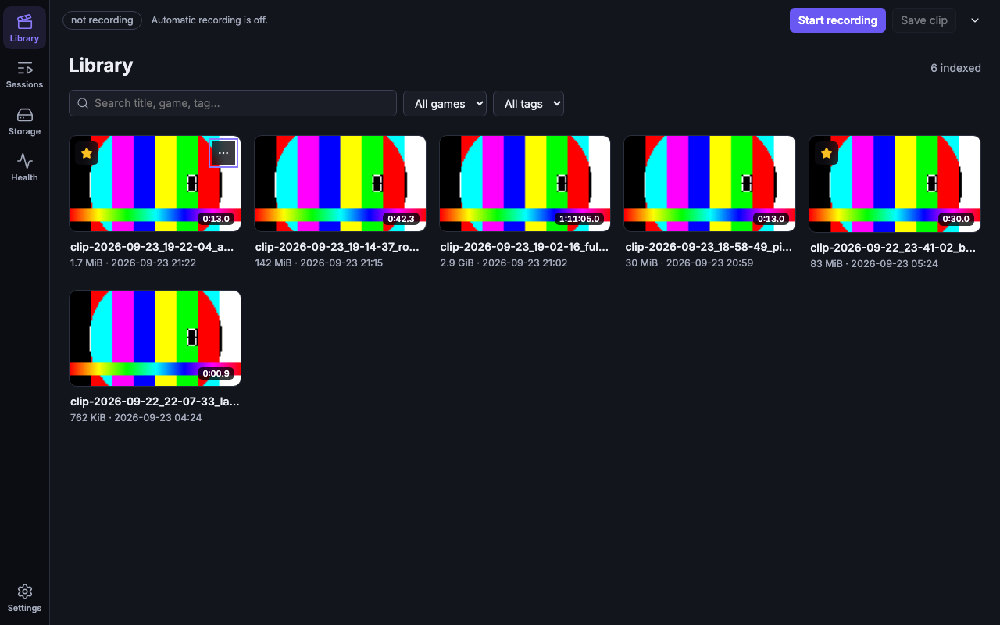
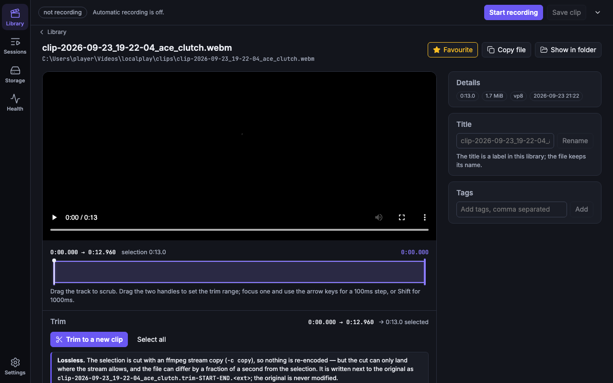
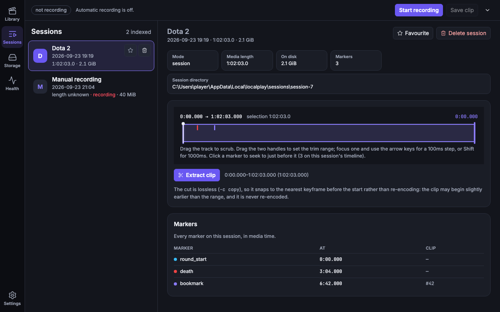
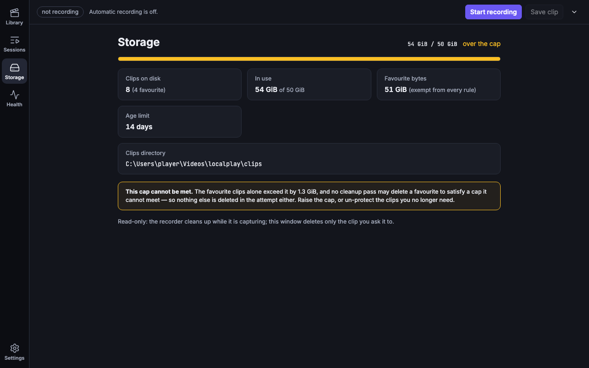

# replayed

> **100% local, zero-cloud game clipping and replay buffer for Windows.**

replayed is an open-source alternative to [Outplayed](https://overwolf.com) and
[Ascent](https://tryascent.gg) that runs entirely on your machine. No account, no
telemetry, no cloud upload, no Overwolf runtime. Just a native desktop app that keeps
the last 30 seconds of your gameplay in a ring buffer — 35 with the shipped default's
30-second pre-roll and 5-second post-roll, and longer if you raise
`buffer.max_pre_seconds` — and writes a lossless clip to disk the instant you press a
hotkey or your game reports an event.

> **Naming.** Everything is `replayed` — the repository, the product, the Start
> Menu shortcut, the install directory (`%LOCALAPPDATA%\replayed`), the window
> title, the tray, the log file (`replayed.log`), the executable (`replayed.exe`),
> the database (`replayed.db`), the GSI config name
> (`gamestate_integration_replayed.cfg`), the Run-key value name and the crates
> (`replayed-cli`, `replayed-encoder`). There is no second name left over from
> the project's earlier spelling.
>
> An install from before the rename keeps its data where it was: the old
> `%LOCALAPPDATA%\localplay` directory is moved over on first start, so the
> clips, the index and the settings are not lost.



| Clip page | Sessions | Storage |
|---|---|---|
|  |  |  |

*Rendered headlessly in Chromium from fixture data (`npm run shots` in `apps/desktop`), not captured
from the real window: WebView2, real-DPI sizing and Inter on Windows have not been seen.*

---

## Using replayed

**This section is for people who want to clip their gameplay.** Everything below it is for
reviewers and developers, and assumes you are reading the source.

- **Install.** The installer is the NSIS package `replayed_<version>_x64-setup.exe`, published on
  the project's [GitHub Releases](https://github.com/FisiFla/replayed/releases) page. **The build
  is not code-signed**, so Windows SmartScreen shows it as coming from an *unknown publisher*:
  choose **More info → Run anyway**.
- **What you need.** Windows 10 1903+ or Windows 11, 64-bit, and a GPU with a hardware encoder
  (NVIDIA, Intel or AMD). The capture path is Windows-only, and there is no software-encoder
  fallback a user can reach.
- **How you clip.** Start a recording from the tray icon or the window, then press **Ctrl+F8**.
  The replay buffer keeps the last 30 seconds in memory, so the clip includes the seconds
  *before* you pressed the key. A game event can cut a clip for you, on the games listed in
  [the user guide](docs/USER-GUIDE.md#the-games-that-are-supported).
- **Where things live.** Everything is under `%LOCALAPPDATA%\replayed` — the clips, the index,
  the logs and the settings. There is no account, no telemetry and no upload.

The full guide — the supported-games matrix, what is and is not recorded, uninstalling, and
troubleshooting — is in **[docs/USER-GUIDE.md](docs/USER-GUIDE.md)**.

> **Status.** replayed is pre-alpha. What has been verified on real Windows hardware, and what
> has only been type-checked, is recorded item by item in
> [`docs/verification-status.md`](docs/verification-status.md) — including the fact that the
> game integrations have never run against a real game.

---

## Non-negotiable principles

These constrain every design decision in this repo. A change that violates one of
these is a bug, not a tradeoff.

| # | Principle | What it rules out |
|---|-----------|-------------------|
| 1 | **Zero cloud, zero logins** | Accounts, telemetry, crash reporting, cloud upload, SaaS dependencies, feature gates |
| 2 | **No Overwolf** | Any dependency on the Overwolf runtime, its SDK, or its ad-injection model |
| 3 | **Minimal resource usage** | Bundled Chromium/Electron, always-on GPU readback, unbounded RAM buffers |
| 4 | **Auto & manual clipping** | Hotkey-only clipping; game events must be able to trigger the buffer too |
| 5 | **Instant scrubbing & trim** | Re-encoding on export. Trims are FFmpeg stream copies — keyframe-aligned, sub-second |

---

## Status

**Pre-alpha, but far past "initialized".** The replay-buffer pipeline, the storage
manager and the desktop app all exist; Phase 1 has run on real Windows hardware six times
(2026-09-23, 09-24, 09-25, 10-15, 10-16 and 10-17), and the desktop GUI was run in a real
session on 2026-09-26; the game-event integrations are implemented. What those runs
*proved* and *refuted* — and, critically, the large amount of Windows code that has been
written and type-checked but **never executed** — is recorded item by item in
[`docs/verification-status.md`](docs/verification-status.md). **Read that file before
trusting anything below.**

The short version: on 4K Windows hardware the pipeline runs and produces correct clips.
The 2026-09-23 session failed the frame-rate and CPU criteria (~24 fps against 30
configured, 1183 of 1814 frames submitted dropped — 65% — and ~50.8% of a core); both are
now met on the zero-copy path — 59.6 of 60 fps with no dropped frames at 3.1–4.0% of one
core (§13, §15). Everything after the 2026-09-24 session is itemised in the ledger, which
records what has since been re-measured on Windows and what has not. The *capture path*
targets Windows only; off Windows the pipeline runs a synthetic stub, so a green `cargo
test` proves none of the eight acceptance criteria.

---

## Privacy

What this app records, and where it goes. Nothing in it phones home.

**What is recorded**

- **Your screen** (the captured display, via Windows Graphics Capture) and **the game's own
  audio** (WASAPI *process* loopback on the watched game's process id, so voice chat and
  music stay out of the clip; while no watched game is running the whole default output is
  captured instead — `[capture] game_audio = "app"` is the default, `"system"` always takes
  everything). These are kept in a rolling buffer (in RAM for the replay buffer; as
  segments on disk for a full session) and only the window around a clip you take, or
  a whole session you chose to record, is saved as a file.
- **Your microphone, only if you turn it on.** It is off by default (`[mic] enabled`) and goes on
  its own audio track.
- **Game events**, only while a recording runs and the matching source is enabled: kills,
  objectives and round boundaries from League of Legends (Riot's local Live Client API) and
  CS2 / Dota 2 (Valve's Game State Integration). They are stored as markers beside the clip or
  session they belong to.
- **A clip index** (a local SQLite database: clip and session paths, sizes, durations, favourite
  flags, the marker rows) and **a log file** of the app's own warnings and errors. The log
  holds file paths and error text, never the GSI token and never footage.

**What the events themselves carry.** The derived game payload is stored **verbatim**, in the
`events.payload` column and in the log: in-game **player names**, kill/death/assist totals, and
for League the match **scoreboard** — every player's name, champion, team, kills, deaths,
assists and an `is_local` flag. It is a record of the match, not a clip of it. The GSI token
and the footage are never in either place.

**Where it lives.** All of it is under one per-user folder (`%LOCALAPPDATA%\replayed`: the
config, the database, the logs, the thumbnails and, unless you chose another folder in
Settings, the clips). Deleting a clip or session in the app deletes its files; uninstalling does
not delete your clips.

**Local only.** There is no account, no sign-in, no telemetry, no crash reporting, no analytics
and no upload. The network traffic the app creates is to your own machine: it polls
`127.0.0.1:2999` for League events and, if enabled, listens on `127.0.0.1` for CS2 / Dota 2.
The listener binds loopback only and rejects any request without its generated token; a test
in `crates/events` asserts that nothing else in that crate opens a socket to a non-loopback
address.

**One exception, and it is yours to press.** *Settings → Updates → Check for updates* asks
whether there is a newer release. That is the only request this application makes to another
machine: one HTTPS GET to this project's own GitHub release page
(`https://github.com/FisiFla/replayed/releases/latest/download/latest.json`), and then, only
if you press **Download and install**, one download of the installer from the same page.
There is no check at startup, no polling, no background task and no telemetry — if you never
press the button, nothing is ever requested. What it downloads is checked against the
minisign public key this build was made with, and a file that does not match is refused
before anything is installed; the private half of that key lives in the release pipeline's
secrets and never ships.

**Your input.** The app never sends keystrokes or mouse input and never writes to a game
client's API. The Settings button that installs the Game State Integration file writes exactly
one file into the game's own `cfg` folder, only when you press it.

---

## Architecture

```
                      ┌──────────────────────────────────────────────┐
                      │  replayed.exe  (Tauri v2 shell)             │
                      │  ┌────────────────────────────────────────┐  │
   global hotkey ────▶│  │  frontend (Vite + webview)             │  │
   Ctrl+F8            │  │  dark-mode timeline / scrubber / trim  │  │
                      │  └───────────────┬────────────────────────┘  │
                      │                  │ Tauri IPC (commands)     │
                      │  ┌───────────────▼────────────────────────┐  │
                      │  │  Rust core                             │  │
                      │  │                                        │  │
                      │  │  ┌──────────┐   ┌──────────────────┐   │  │
   game events ──────▶│  │  │ events   │──▶│ replay (ring buf)│   │  │
   (LoL :2999,        │  │  └──────────┘   └────────┬─────────┘   │  │
    CS2/Dota2 GSI)    │  │                          │             │  │
                      │  │  ┌──────────┐   ┌────────▼─────────┐   │  │
                      │  │  │ capture  │──▶│  encoder (HW)    │   │  │
                      │  │  │ WGC      │   │ NVENC/QSV/AMF    │   │  │
                      │  │  │ + WASAPI │   │ (MFT; ffmpeg     │   │  │
                      │  │  │          │   │  copies the      │   │  │
                      │  │  │          │   │  stream)         │   │  │
                      │  │  └──────────┘   └────────┬─────────┘   │  │
                      │  │                          │             │  │
                      │  │  ┌──────────┐   ┌────────▼─────────┐   │  │
                      │  │  │ media    │◀──│  store (SQLite)  │   │  │
                      │  │  │ ffmpeg   │   │  clips / tags    │   │  │
                      │  │  └──────────┘   └──────────────────┘   │  │
                      │  └────────────────────────────────────────┘  │
                      └──────────────────────────────────────────────┘
                                        │
                          ┌─────────────▼──────────────┐
                          │  RAM ring + clip store     │
                          │  (bounded, RAM-only)       │
                          └────────────────────────────┘
```

### Key flows

**Replay buffer (the core loop).** `capture` continuously pulls GPU frames via
Windows Graphics Capture and hands them to `encoder`, which emits an
already-compressed H.264/HEVC elementary stream. Because the stream is compressed,
the ring buffer holds *packets*, not raw frames — a 120 s buffer costs tens of MB
rather than several GB. The packets are held in **RAM**, bounded by
`buffer.ram_cap_bytes` (256 MiB by default) and evicted oldest-first; **buffering writes
nothing to the disk at all**. (A full *session* recording does write segments to
`sessions/`.) On trigger, `replay` splices the held window
`[trigger − pre_seconds, trigger + post_seconds]` and hands it to `media` for a
lossless `-c copy` container remux.

**Lossless trim.** Every trim is `ffmpeg -ss <t> -i in -c copy out`. No decode, no
encode, no quality loss. The consequence is honest and intentional: cuts snap to the
nearest keyframe. Clip export works around this by forcing a keyframe on the buffer
boundary; arbitrary scrubbing trims accept keyframe granularity.

**Background operation (the desktop app).** `replayed.exe` is a tray application: the
window is a review pane you open when you want it, and *closing* it hides it, because a
clipper that exits when its window closes ends the recording every time its user tidies the
screen. The clip hotkey (`[hotkeys] clip`, `Ctrl+F8` by default) is registered with
`RegisterHotKey` at startup and is what takes a clip while the window is hidden; the tray
icon and its tooltip carry the recording state, and the tray menu shows/hides the window,
starts and stops recording, saves a clip now, opens `config.toml` and quits. A chord that
cannot be registered — another application already owns it, or another replayed does, since
the CLI and the desktop app cannot both hold one chord — is reported in the window, in the
tooltip and in the log, and the window keeps working without it. `[app] start_with_system`
(default `false`) is the Windows Run-key entry.

**Game events.** Two local-only sources, no network egress:
- *League of Legends* — poll `https://127.0.0.1:2999/liveclientdata/allgamedata`
  (its certificate is issued by a root the client pins) for kills/deaths/objectives.
- *CS2 / Dota 2* — a `127.0.0.1`-bound HTTP listener consuming Valve's Game State
  Integration POSTs via a user-installed config file.
- *Everything else* — the global hotkey path, which needs no integration at all.

The one request that leaves the machine is the update check you ask for in *Settings →
Updates*, and it goes to this project's own GitHub release page — see the
[Privacy](#privacy) section above.

---

## Tech stack

| Layer | Choice | Why |
|-------|--------|-----|
| Core | **Rust** | Memory safety, no GC pauses, direct Win32/COM bindings, low RSS |
| GUI shell | **Tauri v2** | Uses the OS webview (WebView2) — no bundled Chromium, ~10 MB shell |
| Frontend | **Vite + Svelte** | Small runtime, fine-grained reactivity fits a live timeline well |
| Capture | **Windows Graphics Capture** (no fallback backend; off Windows a synthetic stub) | Supported on Win10 1903+, per-window capture, no hook injection |
| Audio | **WASAPI process loopback** of the watched game, falling back to the whole default render endpoint; a separate **WASAPI microphone** track of its own | Game audio isn't a capture device; loopback needs no virtual audio driver |
| Encode | **NVENC / QuickSync / AMD AMF** in-process, through a Media Foundation hardware MFT; the bundled `ffmpeg` sidecar only *copies* the resulting stream | Hardware encoding on the GPU at near-zero CPU cost, and one code path for all three vendors. `encode.zero_copy` unset means the hardware path whenever the hardware is there; `false` hands the frames back to ffmpeg's encoder |
| Video I/O | **Bundled `ffmpeg`/`ffprobe` sidecars** | Lossless `-c copy`, thumbnails, remux — no libav build in-tree |
| Index | **SQLite (rusqlite, bundled)** | Single-file, zero-config, embedded; indexes matches/timestamps/tags |

### Rejected alternatives

- **Electron** — 150–300 MB RSS for a UI that shows a timeline. Violates principle 3.
- **Overwolf** — principle 2, and its ad model is the thing we exist to avoid.
- **FFmpeg `gdigrab` for capture** — CPU-bound, no per-window capture, drops frames
  under load. Acceptable as a debug fallback, never as the shipping path.
- **Raw-frame ring buffer** — the frames are ARGB32, 4 bytes a pixel, so 1080p60 raw is
  ~500 MB/s. A 120 s buffer would need ~60 GB of RAM. Compressed-packet buffering is the
  entire trick.

---

## Repository layout

```
replayed/
├── .github/workflows/          # CI: tests + cross-check + frontend (macOS), the workspace
│                               #   test suite (Windows), supply chain + packaging (Ubuntu/Windows)
├── Cargo.toml                  # workspace manifest
├── crates/
│   ├── capture/                # WGC + WASAPI backends (Windows) behind one trait; stub elsewhere
│   ├── encoder/                # the in-process hardware MFT + the ffmpeg sidecar that copies
│   │                            #   its stream, and the NVENC/QSV/AMF selection
│   ├── replay/                 # ring buffer, segment ledger, trigger windows, clip splice
│   ├── recorder/               # the recording engine both front-ends drive
│   ├── media/                  # ffmpeg/ffprobe sidecar driver, lossless trim
│   ├── events/                 # LoL Live Client, CS2/Dota2 GSI
│   └── store/                  # SQLite schema + clip/session/event index, cleanup policy
├── apps/
│   ├── replayed-cli/          # headless binary: a hotkey driver over `recorder`
│   └── desktop/
│       ├── src-tauri/          # Tauri v2 app + IPC command layer over store/recorder
│       └── src/                # Svelte frontend (nav rail, library, clip page, sessions,
│                                #   storage, health, settings)
├── docs/
│   ├── USER-GUIDE.md           # for the people using the app: install, first run, troubleshooting
│   ├── verification-status.md  # what is verified and how — READ IT FIRST
│   ├── platform-traps.md       # OS behaviours (macOS/BSD vs Linux/Windows) that bite
│   ├── packaging.md            # what `tauri build` produces, and what a release still needs
│   ├── anti-cheat.md           # the rules for testing next to an anti-cheat
│   └── runbooks/               # manual (Windows) verification procedures
├── xtask/                      # build helpers: `xtask sidecars …`, `xtask probe`, `xtask verify`
├── scripts/                    # PowerShell glue (run the harness in a desktop session)
├── config.example.toml
├── LICENSE-MIT
├── LICENSE-APACHE
└── .gitignore
```

Start with [`docs/verification-status.md`](docs/verification-status.md) — the honest
ledger of what is verified, what is only type-checked, and what is unverified — and
[`docs/platform-traps.md`](docs/platform-traps.md) for the OS behaviours that have already
caused two bugs here. The architecture is described above; Phase 1 acceptance is in the runbooks under
[`docs/runbooks/`](docs/runbooks/).

### Game event integrations (Phase 4)

Two sources, both **loopback-only by construction** and both switched on from `[events]` in
the config file:

- **League of Legends** — polls Riot's Live Client Data API
  (`https://127.0.0.1:2999/liveclientdata/allgamedata`) once a second while a game is
  running. The endpoint's certificate is issued by a root the client **pins** (the
  platform roots are disabled), so nothing is relaxed but the host-name match — an IP
  literal has no name to satisfy. The relaxation lives in exactly one file, the one that
  also pins the address, and a guard test asserts that no file in the tree disables
  chain verification and that exactly one may relax the host-name check.
- **CS2 / Dota 2** — a `127.0.0.1`-bound HTTP listener for Valve's Game State Integration.
  It requires a generated token (which the game echoes back inside the payload's `auth`
  object), rejects anything that does not carry it, and generates the
  `gamestate_integration_replayed.cfg`. In the desktop app, **Settings > Game integrations**
  has an Install button that finds the game in your Steam libraries and writes that file into
  its `cfg` folder (after checking the destination stays inside the game's install folder);
  otherwise copy the generated file there yourself.

An event takes a clip through **the hotkey's own trigger** — same pre-roll, same post-roll,
same lossless splice in media time — and writes why it was taken into the `events` table,
linked to the clip. A kill, a bomb or the end of a match clips; a round boundary is recorded
as a timeline marker without taking footage. No game has been contacted to verify any of
this yet: the payloads are canned fixtures and the servers are mocks in the test process.

---

## Prerequisites (target: Windows 10 1903+ / Windows 11)

- **Rust** stable (MSVC toolchain)
- **Node.js** 20+ and npm
- **WebView2 Runtime** (preinstalled on Win11, evergreen on Win10)
- A GPU with a hardware encoder: NVIDIA (NVENC), Intel (QuickSync), or AMD (AMF)
- `ffmpeg`/`ffprobe` — either install them on `PATH`, **or fetch the pinned sidecars**
  with `cargo xtask sidecars fetch` (see below). They are not committed.

> **Note:** the *capture path* is Windows-only. The repository builds and its test suite
> runs on macOS, Linux and Windows (CI runs it on `macos-latest` and on `windows-latest`);
> off Windows the pipeline uses a synthetic `StubCapture`, so a green test run proves none
> of the acceptance criteria — see
> [`docs/verification-status.md`](docs/verification-status.md).

### Getting the sidecars

The last item is a command, not a manual download. The URL and the SHA-256 of the archive
it must serve live in `xtask/sidecars.toml`; `fetch` verifies the archive against that hash
and extracts only the two binaries it lists, into `binaries/` (gitignored):

```sh
cargo xtask sidecars record    # download, print and record each archive's sha256 (once)
cargo xtask sidecars fetch     # verify the recorded hash, then extract
# a Windows sidecar can be fetched and inspected from macOS or Linux:
cargo xtask sidecars fetch --target x86_64-pc-windows-msvc
```

`record` writes a **trust-on-first-use** pin: it cannot attest who served the archive, only
the bytes to expect from then on, so the URL and the hash are meant to be reviewed in the
diff and committed. At runtime the app looks, in order, for `binaries/` **next to the
executable** (the Windows installation directory, i.e. where the installer's resource mapping
puts it), then for the **resources of an installed bundle** (`Contents/Resources/binaries`
inside a macOS `.app`), then — for a `cargo run` checkout only — for a `binaries/` directory at
the root of the project the executable lives under, and finally on `PATH`. Installing `ffmpeg`
system-wide is therefore not required, which is the point. The packaging story — what
`tauri build` produces, where the sidecars land, and what a release still needs — is in
[`docs/packaging.md`](docs/packaging.md).

### Verifying a Windows box

The one command that runs the acceptance checks and writes down what it saw:

```powershell
cargo xtask verify
```

It starts the buffer with a bounded, documented configuration (printed in the report) and
takes a clip through the CLI's own in-process `--self-test-clip-after` trigger — **no
keyboard or mouse input is synthesised, sent or injected anywhere in it** — then probes
that clip with ffprobe: duration against the configured window, stream count, codec,
resolution, A/V drift and audio level, next to the process's own CPU and memory against
criterion 6's thresholds, the media-vs-wall-clock ratio, the RAM budget
(`buffer.ram_cap_bytes`) and the eviction row — which reads the ring's own `evicted=`
counter out of the status line, so it passes in buffer mode, where nothing is written to the
disk at all — and criterion 7's fail-loud encoder path. Everything lands in
`target\verify\report.md`, raw output inline; checks it cannot perform are marked *not
performed* with the reason, and it exits non-zero only when a check actually failed
(`--strict` makes a *not performed* row a non-zero exit too). From a remote
(non-interactive) shell — where there is no desktop to
capture — use `scripts\verify-in-interactive-session.ps1`, which runs it in the logged-on
user's session through a one-shot scheduled task and cleans the task up afterwards.

The harness first ran on Windows on 2026-10-15 (it was built on macOS against the synthetic
backends) and again on 2026-10-16, after the harness itself was corrected; its own report
is still part of what a fresh run checks. It cannot verify
the GUI window, a real keypress, anything needing a real game, or the live capture-clock
divergence; §9 of [`docs/verification-status.md`](docs/verification-status.md) lists what
stays manual.

---

## Roadmap

- [x] **Phase 0** — repo, tooling, design spec
- [x] **Phase 1** — capture + loopback audio + hardware encode + ring buffer + hotkey trigger (PoC).
      **Ran on real Windows hardware** and produced correct clips. The 4K shortfall found on
      2026-09-23 ([issue #1](https://github.com/FisiFla/replayed/issues/1), closed) is
      fixed by the zero-copy path, where captured textures go straight to the hardware encoder:
      59.6 of 60 fps with no dropped frames and 3.1–4.0% of one core
      ([`docs/verification-status.md`](docs/verification-status.md) §13–§15).
- [x] **Phase 2** — Tauri shell, timeline scrubber, clip trim. The window and its
      recording wiring exist, and so do the tray, the global clip hotkey and the
      hide-on-close behaviour that make it a background application; all of it is exercised
      **headlessly in CI**, and the window itself was opened once on the Windows test
      machine on 2026-09-26 — the tray, the keypress and the hide have never been observed
      on any machine.
- [x] **Phase 3** — SQLite index, storage manager, auto-cleanup policies *(host-verified,
      and the bundled-SQLite store now builds and its tests run on the Windows box too)*
- [x] **Phase 4** — LoL Live Client + CS2/Dota2 GSI event integrations *(implemented and
      tested against local mocks; **never run against a real game** — see
      [`docs/verification-status.md`](docs/verification-status.md))*
- [ ] **Phase 5** — full-session recording, chapter marks, packaging/installer. The recording
      and the chapter marks are **done**: full-session mode with lossless finalise and crash
      recovery, an optional microphone on its own track, game-driven auto-record (off by
      default), the session IPC and a desktop session view that plots the markers and cuts a
      clip out of a finished session. What keeps this item unticked is **packaging**: bundling
      and the sidecar resource mapping are configured and a macOS `.app` was built and
      inspected, and the **Windows installer now builds, installs, uninstalls and reinstalls on
      real hardware** ([`docs/packaging.md`](docs/packaging.md) §3.5 — measured 2026-09-26, first
      time any of it was observed rather than inferred). What is still missing is **code signing
      and notarisation**. The auto-updater **now exists** — a signed, user-initiated check
      against this project's own GitHub Releases, with the artifact checked against a pinned
      minisign key before it is installed — but it has **never been used end to end**: no
      release has been signed with the release key and offered to an installed copy yet, so
      what is missing there is the evidence, not the code
      ([`docs/verification-status.md`](docs/verification-status.md) §27).

> **Caveat on every `[x]` above.** The Windows-only surface has now run on Windows: on
> 2026-09-24 the whole Rust workspace was built **and its test suite executed** on the Windows test machine,
> and a real desktop session produced a clip — WGC capture, WASAPI loopback, a microphone
> track surviving the concat and `h264_nvenc` chosen by `vendor = "auto"`, all for the first
> time. Three test defects were found and fixed by doing it, and the fourth failure — the
> audio timeline, not a test defect at all — was later explained and fixed (ledger §10.4).
> What has *still* never run anywhere: the
> either game integration against a real game, and any synthesised keypress. (The desktop GUI
> did run on the Windows test machine on 2026-09-26, and `cargo xtask verify` on 2026-10-15; the tray, the
> keypress and hide-on-close are still unobserved.) The per-item truth is in
> [`docs/verification-status.md`](docs/verification-status.md) — §10 is that session, and its
> headline paragraph is the short version.

Phase 1's eight acceptance criteria and how to run them are in the
[Phase 1 verification runbook](docs/runbooks/phase-1-verification.md).

---

## License

Dual-licensed under either of

- Apache License, Version 2.0 ([LICENSE-APACHE](LICENSE-APACHE))
- MIT license ([LICENSE-MIT](LICENSE-MIT))

at your option. This is the Rust ecosystem convention and is compatible with
shipping an LGPL-licensed `ffmpeg` sidecar.

The desktop window also bundles the Inter and JetBrains Mono typefaces (SIL OFL 1.1) and a
subset of the Lucide icons (ISC); their licence texts are in
[apps/desktop/THIRD_PARTY_NOTICES.md](apps/desktop/THIRD_PARTY_NOTICES.md).

### A note on the `ffmpeg` build

replayed only ever uses **hardware** encoders (`nvenc`/`qsv`/`amf`) and stream copy,
so it never requires `libx264`. That means an **LGPL** `ffmpeg` build is sufficient,
and shipping it does not pull the GPL `libx264`/`libx265` obligations into this
project.
